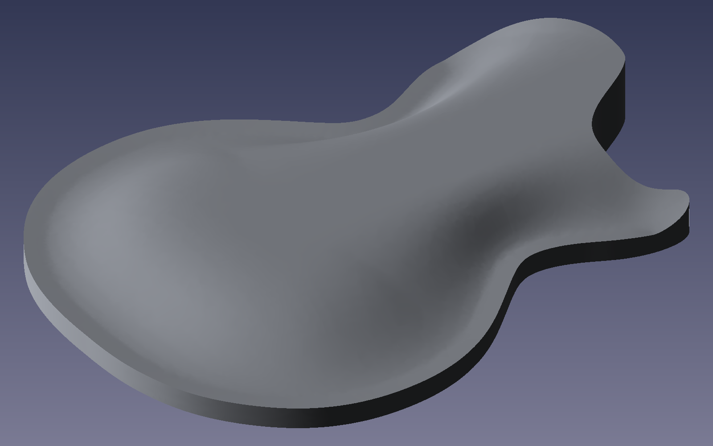

# Les Paul Top Carve for FreeCAD

A FreeCAD macro that carves the top of a solid-body guitar blank into a Les Paul
style arched cap. Click the flat top face, run the macro, and get a new carved
body. Your original body is hidden, not changed.



*A body carved with the default settings. Height is exaggerated 2.5x so the carve is easier to see.*

- 14 mm removed at the outer rim, falling to 2 mm at a flat crown
- A soft S-curve shoulder between the rim and the crown
- A flat central strip running through the waist to the front
- An open front, so the neck angle can be planed in by hand for each build

See [docs/design.md](docs/design.md) for how the shape is built, and
[docs/development.md](docs/development.md) for working on the code.

## Requirements

- FreeCAD 1.x. Tested on FreeCAD 1.1.4 on macOS. It uses the numpy bundled with FreeCAD.

## Files

| File | Purpose |
|---|---|
| `les_paul_carve.py` | Carve geometry. No GUI code. All parameters live in `CarveParams`. |
| `LesPaulCarveTop.FCMacro` | FreeCAD macro: takes the selected face and adds the carved result. |
| `install.sh` | Copies the macro and library into FreeCAD's macro folder. |
| `test_les_paul_carve.py` | Headless tests, run with FreeCAD's command-line tool. |
| `docs/` | Design and development notes. |

## Install

```bash
git clone <this repository's URL>
cd Freecad-Les-Paul-Carve-Plugin
./install.sh                                  # uses /Applications/FreeCAD.app
./install.sh "/path/to/FreeCAD.app"           # if FreeCAD is elsewhere
```

The installer asks FreeCAD for its macro folder, so it works across FreeCAD versions. It
installs:

- `LesPaulCarveTop.FCMacro` into the macro folder. This is the file you run.
- `les_paul_carve.py` into a `LesPaulCarve_lib/` subfolder. This is the library. It is not a macro.

Restart FreeCAD afterwards.

## Use

1. Open your body in FreeCAD. The body needs a flat top face (normal +Z) that is the top
   of the blank.
2. In the 3D view, click that flat top face. Do not select the body in the tree.
3. Run **Macro > Macros... > LesPaulCarveTop > Execute**.
4. A `CarvedTop_<body>` object appears and the original body is hidden. The status bar
   reports the removed volume and the crown position.

If nothing seems to happen, read `~/les_paul_carve_macro.log`. Every run writes to it.

The macro sets a fine display mesh on the result. If an older carved object looks faceted or
shows a zig-zag along the shoulder, that is FreeCAD's coarse default display mesh, not the
surface. Select the object, and in the Property view's **View** tab set **Deviation** to `0.05`
and **Angular Deflection** to `5`.

Messages you may see:
- "Select exactly one FACE": nothing was selected, or more than one object was.
- "must be a horizontal face": you clicked a side face. Click the top face.
- "points down": you clicked the bottom face. Click the top face.

## Tune the carve

Edit `CarveParams` in `les_paul_carve.py`, then run `./install.sh` again. All values are in mm.

| Parameter | Default | Meaning |
|---|---|---|
| `edge_removal` | 14 | Material removed at the outer rim. |
| `peak_removal` | 2 | Material removed at the flat crown. |
| `rim_width` | 14 | Distance in from the rim to the first line. |
| `rim_dip` | 0.5 | How far the first line sits below the rim. |
| `crown_fraction` | 0.88 | Where the flat crown starts, as a fraction of the maximum distance from the edge. Lower = bigger flat top. |
| `profile_exponent` | 2.0 | Shoulder S-curve sharpness. 1 = straight ramp. |
| `shoulder_bias` | 0.7 | Skews the S-curve. 1 = symmetric. Below 1 = steepest near the edge. |
| `corridor_half_width` | 28 | Half-width of the flat central strip. |
| `open_front_fraction` | 0.20 | Fraction of body length at the front that is treated as an open edge. |
| `neck_direction` | (1, 0) | Direction from tail to neck. |
| `neck_features` | True | `False` gives only the lower-bout dome, with the rim all the way round. |
| `smoothing` | 8 | Blur of the height field, in mm. |
| `grid_step` | 4 | Sample spacing, in mm. Smaller is finer and slower. |

## Tests

```bash
FC=/Applications/FreeCAD.app/Contents/Resources/bin/freecadcmd
CARVE_TEST_FCSTD="/path/to/your/body.FCStd" \
  "$FC" -c "exec(open('$PWD/test_les_paul_carve.py').read())"
```

The last line should read `=== ALL PASSED`. Results are also written to `test_report.txt`.

- Without `CARVE_TEST_FCSTD` the real-body tests are skipped. The geometry tests still run.
- The real-body tests work on a temporary copy and never modify your file.
- Set `CARVE_TEST_OUT=/some/folder` to keep the carved STEP files.

The tests cover a rectangle with a known analytic answer (the profile matches to within
0.05 mm), the rim dip, the flat crown, the open front, the flat waist, and edge smoothness on
a real body. They do not drive the GUI, so check the macro in FreeCAD itself.

## Limits

- Distance is measured from the **closed** part of the outline. The front (horn tip and
  cutaway) is an open edge, so the top stays at crown height there. Plane the neck angle in by hand.
- Only the top is carved. The bottom, sides and cavities are unchanged. Keep `edge_removal`
  well under the thickness of the body you carve.
- The result is a B-spline surface. It loads and exports to STEP correctly.
- A carve of a body that size takes a few seconds.
- The depths (14 mm at the rim, 2 mm at the crown) and the S-curve come from a cross-section
  reference. Check them against your own spec before cutting.

## License

MIT. See [LICENSE](LICENSE).

The software is provided as is. Check every carve against your own measurements before cutting wood.
